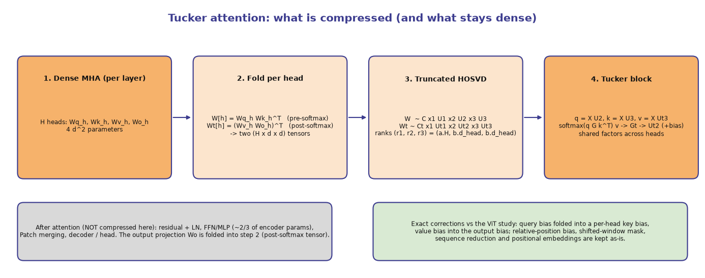
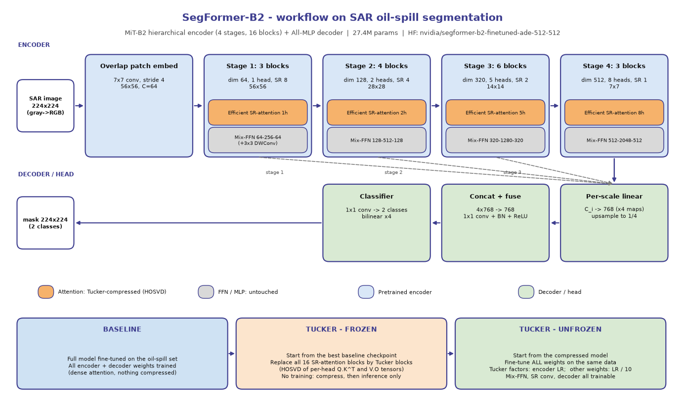
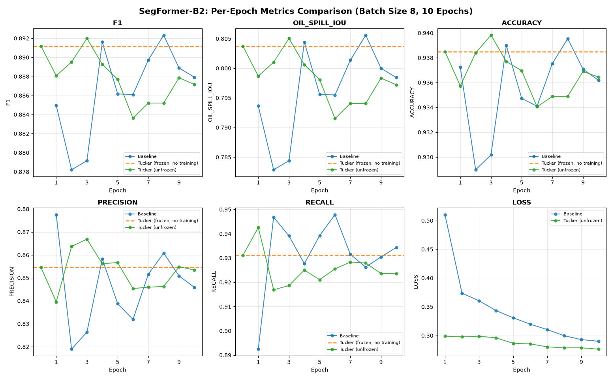

## Cross-model summary

| Model | Params (M) | Attn share | Attn compression | Baseline IoU | Frozen IoU | Unfrozen IoU | Δ unfrozen | Baseline F1 | Unfrozen F1 | ms/img base→Tucker (bf16) | GFLOPs base→Tucker |
|---|---|---|---|---|---|---|---|---|---|---|---|
| SegFormer-B2 | 27.3 | 22% | 3.6x | 80.56 | 80.37 | 80.50 | -0.06 | 89.23 | 89.20 | 3.2 → 4.0 | 21.9 → 21.5 |

## Architecture inventory: where the parameters are

| Model | Total (M) | Attention | FFN / MLP | Other encoder | Decoder / head | FFN SVD param-ratio @95% / @90% energy | Cross-layer Tucker-3 ratio @95% / @90% |
|---|---|---|---|---|---|---|---|
| SegFormer-B2 | 27.3 | 5.93M (22%) | 12.02M (44%) | 6.25M (23%) | 3.15M (12%) | 0.96 / 0.84 | 1.00 / 0.86 |
| Swin-T + UperNet | 58.9 | 8.64M (15%) | 17.27M (29%) | 1.60M (3%) | 31.42M (53%) | 0.95 / 0.80 | 1.00 / 0.82 |
| Mask2Former (Swin-T) | 47.4 | 13.38M (28%) | 29.89M (63%) | 1.60M (3%) | 2.53M (5%) | 0.96 / 0.82 | 1.00 / 0.83 |
| Swin-UNETR (2D) | 25.1 | 1.57M (6%) | 3.14M (12%) | 1.59M (6%) | 18.83M (75%) | 0.96 / 0.79 | 1.00 / 0.81 |
| TransUNet (R50-ViT-B/16) | 105.3 | 28.35M (27%) | 56.67M (54%) | 12.87M (12%) | 7.39M (7%) | 0.95 / 0.83 | 0.98 / 0.74 |

## SegFormer-B2

### Results (best epoch by oil-spill IoU, single seed)

Headline Tucker level: **L3_h1_d1** — attention 3.6× smaller
(5.93M → 1.63M parameters, 16 attention blocks).

| Metric (%) | Baseline | Tucker frozen | Tucker unfrozen | Δ frozen | Δ unfrozen |
|---|---|---|---|---|---|
| F1 | 89.23 | 89.12 | 89.20 | -0.11 | -0.03 |
| Mean F1 | 92.51 | 92.42 | 92.51 | -0.10 | -0.00 |
| Oil-spill IoU | 80.56 | 80.37 | 80.50 | -0.19 | -0.06 |
| Mean IoU | 86.25 | 86.08 | 86.25 | -0.17 | +0.00 |
| Accuracy | 93.95 | 93.85 | 93.98 | -0.10 | +0.03 |
| Precision | 86.08 | 85.46 | 86.68 | -0.62 | +0.60 |
| Recall | 92.62 | 93.11 | 91.86 | +0.48 | -0.76 |

| Last-3-epoch mean (%) | Baseline | Tucker unfrozen | Δ |
|---|---|---|---|
| F1 | 88.97 | 88.67 | -0.30 |
| Oil-spill IoU | 80.13 | 79.65 | -0.48 |
| Accuracy | 93.76 | 93.61 | -0.15 |
| Precision | 85.25 | 85.15 | -0.10 |
| Recall | 93.04 | 92.50 | -0.53 |
| Std of IoU, last 5 epochs | 0.37 | 0.27 | |

**Rank sweep (Tucker frozen = compress + inference only)**

| Config | Attention params | Attention compression | Total params (M) | Oil-spill IoU (%) | F1 (%) | GFLOPs | ms/img (bf16) |
|---|---|---|---|---|---|---|---|
| Baseline (dense) | 5.93M | 1.0x | 27.35 | 80.56 | 89.23 | 21.9 | 3.20 |
| Frozen L1_h1/3_d1/4 | 0.308M | 19.2x | 21.73 | 68.70 | 81.45 | 20.6 | 3.75 |
| Frozen L2_h1/2_d1/2 | 0.636M | 9.3x | 22.05 | 77.57 | 87.37 | 20.8 | 3.81 |
| Frozen L3_h1_d1 **(fine-tuned)** | 1.625M | 3.6x | 23.04 | 80.37 | 89.12 | 21.5 | 3.79 |
| Frozen L4_h1_d2 | 4.165M | 1.4x | 25.58 | 80.58 | 89.24 | 22.6 | 3.81 |

**Resources**

| Metric | Baseline | Tucker frozen | Tucker unfrozen |
|---|---|---|---|
| Parameters (M) | 27.35 | 23.04 | 23.04 |
| GFLOPs / image (fwd, 224²) | 21.9 | 21.5 | 21.5 |
| Latency bf16 (ms/img, batch 8) | 3.20 | 3.79 | 4.02 |
| Latency fp32 (ms/img, batch 8) | 3.93 | 4.08 | 4.39 |
| Inference peak memory, bf16 (MB) | 1284 | 1263 | 1530 |
| Training time (s) | 1075 | - | 1158 |
| Training peak memory (MB) | 1763 | - | 2055 |

**Confusion matrix at best epoch (pixels)**

| Run | TN | FP | FN | TP |
|---|---|---|---|---|
| Baseline | 55,832,508 | 3,282,953 | 1,616,521 | 20,302,258 |
| Tucker frozen | 55,642,836 | 3,472,625 | 1,510,970 | 20,407,809 |
| Tucker unfrozen | 56,022,611 | 3,092,850 | 1,783,543 | 20,135,236 |

**FFN probe (what happens if the feed-forward weights are compressed instead)**

| FFN scheme (post-hoc on baseline, no retraining) | FFN param ratio | Oil-spill IoU (%) | F1 (%) |
|---|---|---|---|
| none (reference) | 1.00 | 80.56 | 89.23 |
| per-layer low-rank (Tucker-2 / SVD) | 0.50 | 74.50 | 85.39 |
| per-layer low-rank (Tucker-2 / SVD) | 0.25 | 51.34 | 67.85 |
| cross-layer Tucker-3 (shared factors) | 0.50 | 41.79 | 58.94 |
| cross-layer Tucker-3 (shared factors) | 0.25 | 48.35 | 65.19 |

